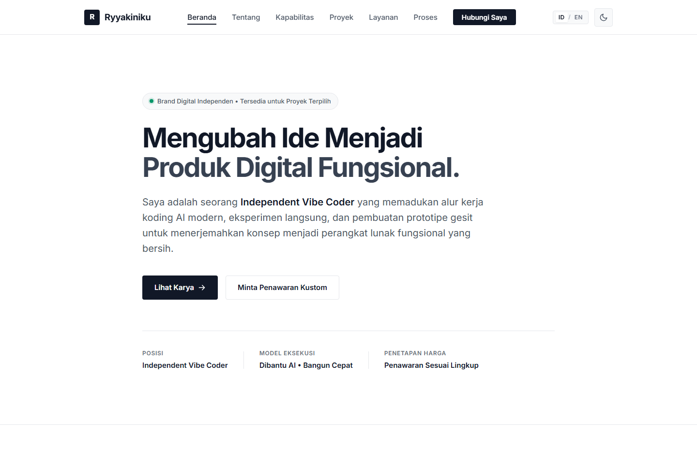
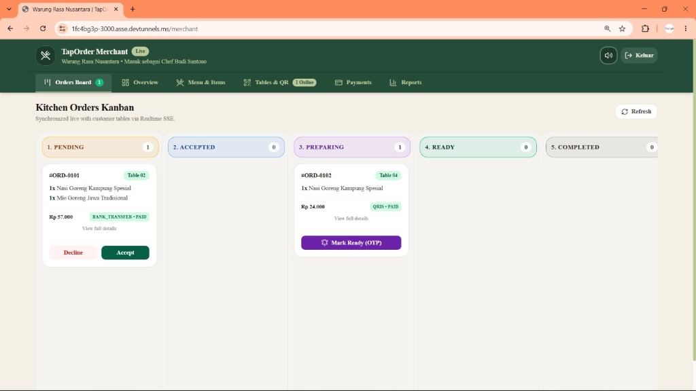
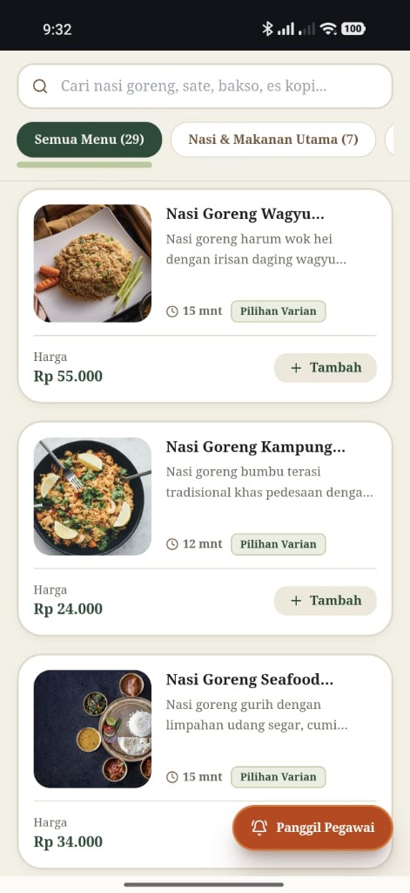
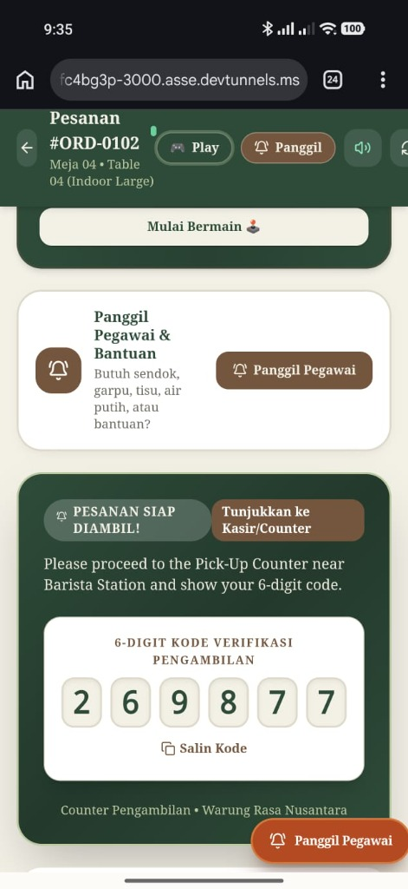
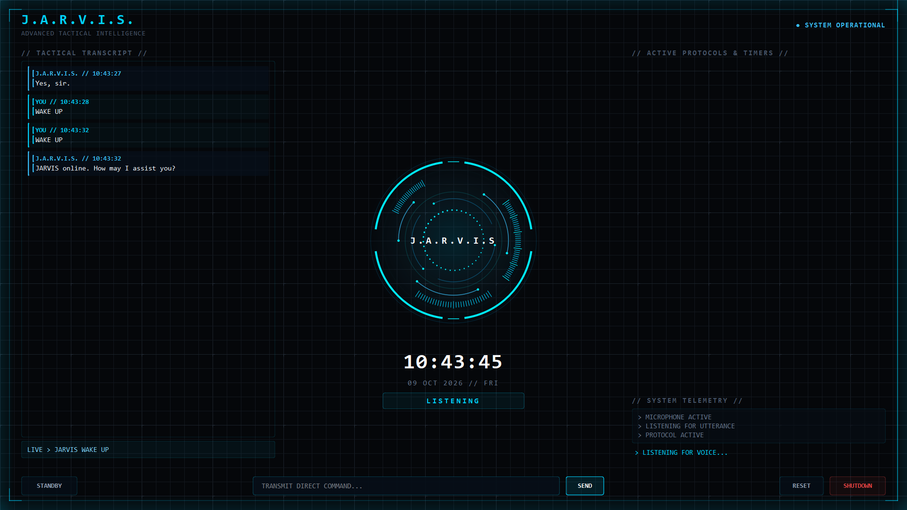
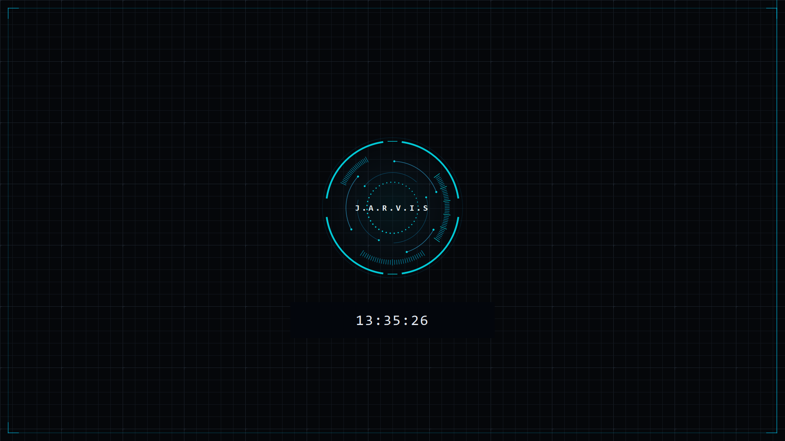
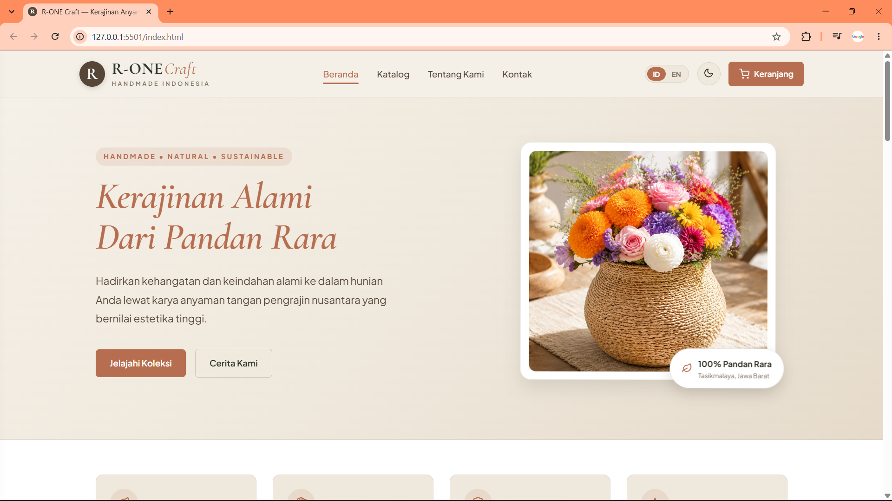
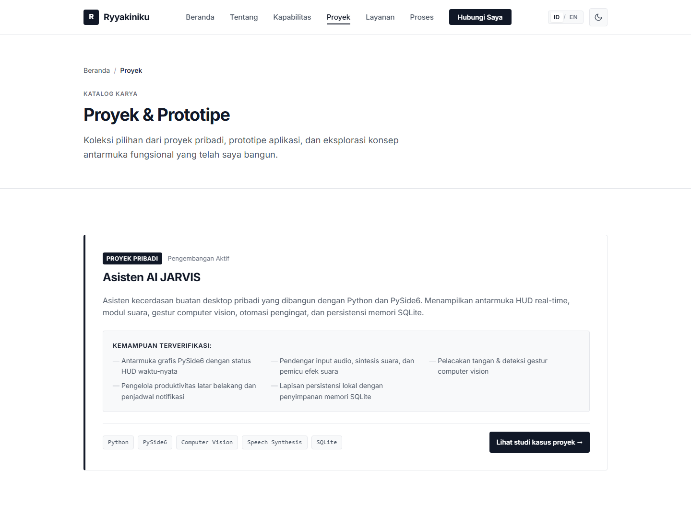
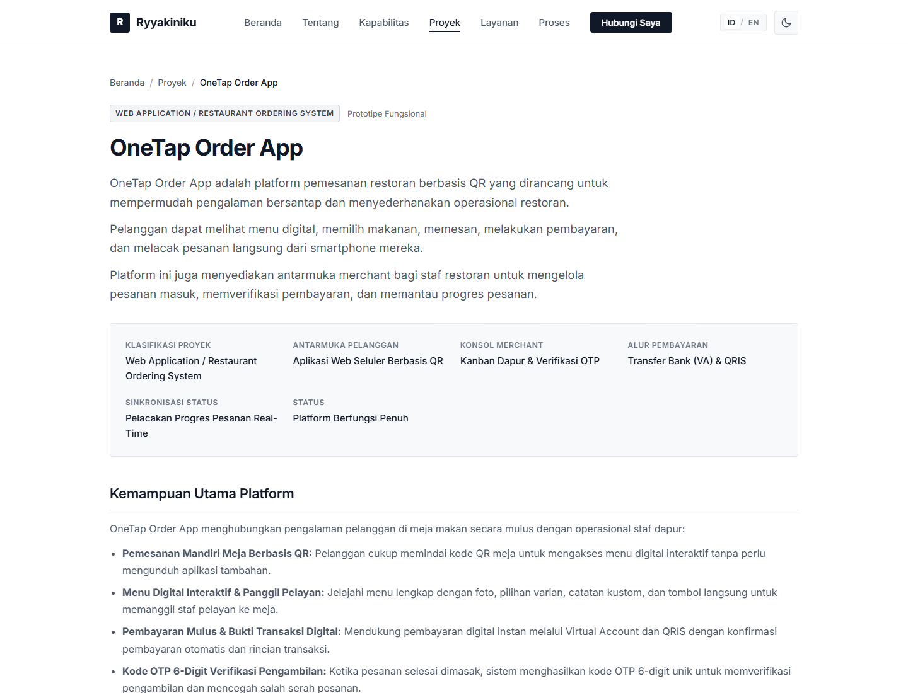
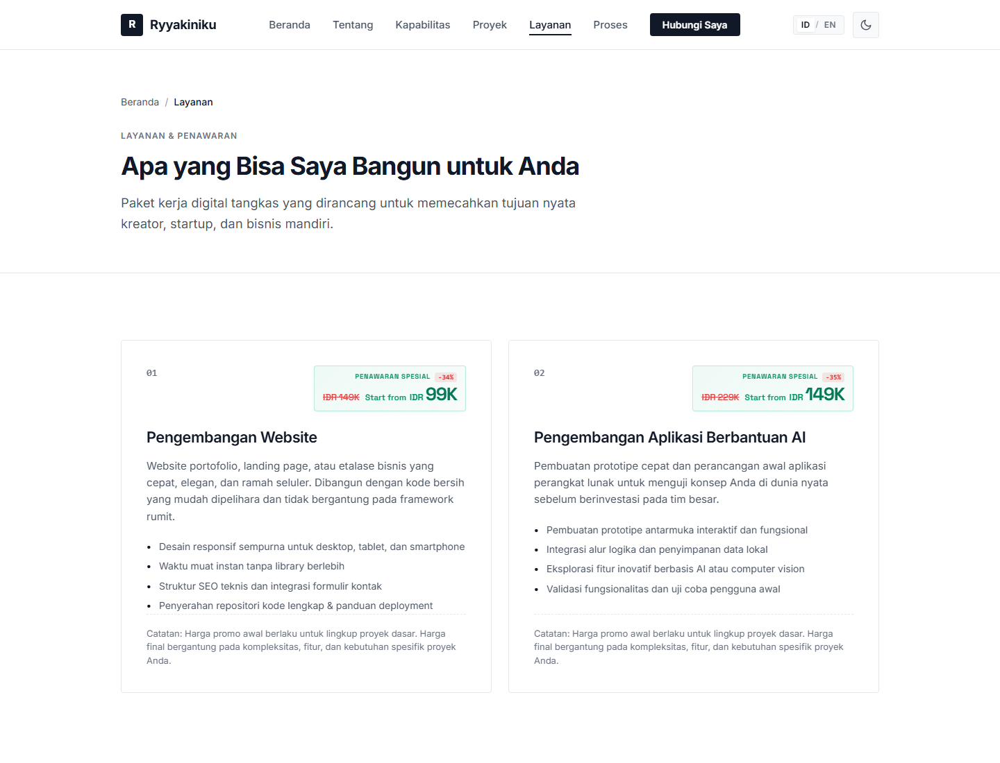

# Ryyakiniku — Portfolio Showcase

> **Turning Ideas Into Functional Digital Products.**  
> Official portfolio showcase of **Ryyakiniku**, Independent Vibe Coder.

---

## 🌐 Live Website

Experience the live portfolio in production:  
👉 **[https://ryyakiniku.vercel.app](https://ryyakiniku.vercel.app)**

---

## 📸 Portfolio Preview

---

## 📖 Project Overview

**Ryyakiniku** is an independent digital portfolio engineered to bridge the gap between initial concepts and working software. Built with a focus on speed, pragmatism, and clean aesthetics, the portfolio showcases verified personal software builds, interactive prototypes, and novel interface experiments.

The platform embodies the **Vibe Coding** philosophy: combining modern AI-assisted engineering workflows with direct hands-on problem-solving to deliver fast, dependable, and bloat-free digital products.

---

## ✨ Key Portfolio Features

- **🌓 Dual-Theme System (Dark Mode / Light Mode):**
  - High-contrast monochrome palette carefully balanced for visual comfort.
  - Smooth theme transitions with local persistence (`localStorage`).
  - Seamless support for first-time visitors and recurring sessions.

- **🌐 Centralized Bilingual Architecture (ID / EN):**
  - Instant client-side language switching between Bahasa Indonesia and English.
  - Zero page reload required with structured dictionary-based translations.
  - Local preference memory to remember selected language across pages.

- **⚡ Zero-Bloat Performance:**
  - Built entirely without heavy JavaScript frameworks or external UI dependencies.
  - Semantic HTML5 structure providing near-instantaneous Time to First Byte (TTFB) and smooth 60fps scrolling.

- **🔍 Accessible Image Lightbox:**
  - High-resolution modal preview for all project galleries.
  - Full keyboard accessibility (Esc to close, Left/Right arrow navigation).
  - Graceful fallback placeholders preventing broken-image layout shifts.

- **📱 Fully Responsive Design:**
  - Mobile-first responsive layouts across desktop displays, tablets, and smartphones.
  - Clean touch-friendly navigation drawer and controls.

---

## 🛠️ Technology Stack

| Layer | Technologies & Design Patterns |
| :--- | :--- |
| **Markup & Semantics** | Semantic HTML5, Accessible ARIA standards, Open Graph metadata |
| **Styling & Theming** | Modern CSS3, Design Tokens (`CSS Custom Properties`), CSS Grid, Flexbox |
| **Interactivity & Logic** | Vanilla JavaScript (ES6+), DOM Manipulation, Web Storage API (`localStorage`) |
| **Typography** | Inter (primary reading font) & Space Grotesk (pricing & numerical accents) |
| **Delivery & Edge** | Static delivery optimized for Vercel Edge Network |

---

## 🚀 Featured Projects Showcase

The portfolio hub features three core verified applications and functional prototypes:

### 1. OneTap Order App
> **Web Application / Restaurant Ordering System**

A QR-based restaurant ordering and merchant kitchen management platform designed to streamline the dining experience and simplify food and beverage operations.

- **Customer Flow:** Diners scan a table QR code to browse categorized digital menus, customize food options, place orders, complete payments via Bank Transfer (VA) / QRIS, and track order stages live.
- **Merchant Console:** Restaurant staff manage incoming orders via a real-time Kanban board across stages (*Pending*, *Accepted*, *Preparing*, *Ready*, *Completed*).
- **OTP Verification:** Handover security with unique 6-digit verification codes to eliminate order release errors.

| Merchant Kitchen Kanban | Mobile Digital Menu | 6-Digit Pickup OTP |
| :---: | :---: | :---: |
|  |  |  |

---

### 2. JARVIS AI Assistant
> **Personal Desktop Artificial Intelligence Assistant**

An independent desktop assistant engineered using Python and PySide6, featuring a modern HUD interface, local offline speech synthesis, and real-time computer vision detection.

- **PySide6 Real-Time HUD:** Responsive dynamic interface with active telemetry and mode indicators.
- **Computer Vision Gestures:** Real-time hand landmark tracking and touchless gesture interaction.
- **Local Persistence & Productivity:** SQLite-backed memory core and background worker notification scheduler.

| PySide6 HUD Interface | System Dashboard |
| :---: | :---: |
|  |  |

---

### 3. Handicraft Website & Catalog Showcase
> **Artisanal Product Showcase & Editorial Concept**

An artisanal digital catalog concept celebrating local craftsmanship and natural botanicals. Built with warm earth tones, editorial typography, and zero-framework performance.

---

## 📑 Portfolio Page Highlights

### Projects & Prototypes Showcase Hub

### OneTap Order App Case Study Detail

### Services & Scope-Based Pricing

---

## 🔗 Official Links & Contact

- **Production Website:** [https://ryyakiniku.vercel.app](https://ryyakiniku.vercel.app)
- **GitHub Profile:** [https://github.com/Ryyakiniku](https://github.com/Ryyakiniku)
- **Direct Inquiries:** Available via the contact form at [ryyakiniku.vercel.app/contact.html](https://ryyakiniku.vercel.app/contact.html)

---

© 2026 Ryyakiniku. Independent Digital Brand. All rights reserved.
